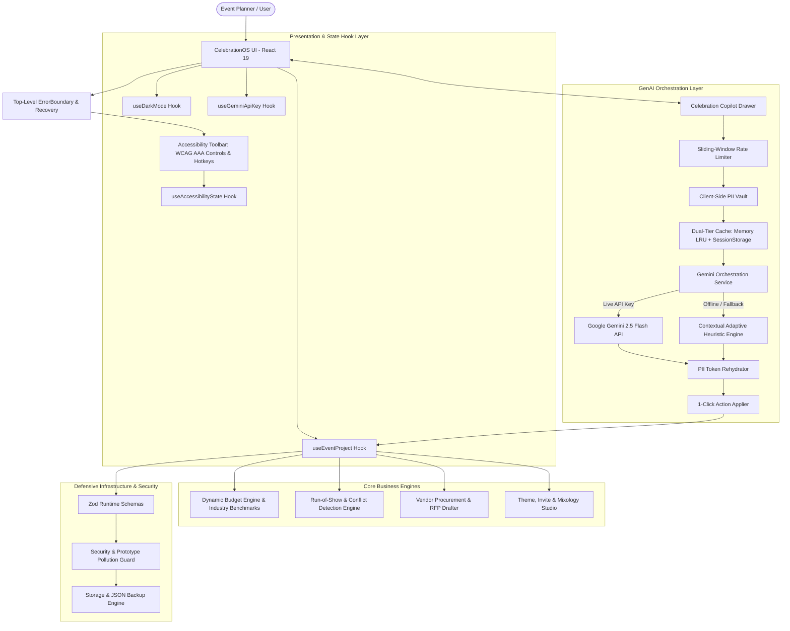

# CelebrationOS System Architecture 🏗️

> **Technical Architecture, Layered Abstraction, and Data Flow Design**  
> *Google PromptWars — Challenge 5: Celebration & Event Planner*

---

## 1. Executive Architectural Blueprint

CelebrationOS is architected as an **Enterprise Event Operating System** implementing unidirectional data flow, clean separation of concerns, and defensive zero-defect engineering.

---

## 2. Layered Component Architecture

### 2.1 Presentation Layer (`src/components/`)
- **`overview/`**: Event executive hero, countdown telemetry, financial gauges, and core metadata editing.
- **`budget/`**: Category breakdown, multi-currency engine, cost-per-guest analysis, contingency buffer calculations, and benchmark auto-allocations.
- **`timeline/`**: Dual-perspective run-of-show scheduler, milestone countdown roadmap, time parser, and automated conflict detector.
- **`vendors/`**: Complete vendor procurement lifecycle tracker (`Researching` ➔ `Completed`), contract/deposit status, and GenAI RFP inquiry email drafter.
- **`ideas/`**: Curated color palettes with copyable swatches, digital invitation copy drafter, signature mixology recipes, and speech/toast coach.
- **`assistant/`**: Context-aware slide-over copilot drawer with action buttons and live engine indicator.
- **`common/`**: Accessible primitives (`AccessibilityBar`, `Button`, `Badge`, `Card`, `Modal`, `ErrorBoundary`).

### 2.2 Custom React Hooks (`src/hooks/`)
- **`useEventProject`**: Encapsulates project data mutations, preset transitions between vertical domains (Weddings, Birthdays, Community events), currency conversions, and JSON import/export.
- **`useAccessibilityState`**: Manages keyboard navigation hotkeys (`Alt+A`, `Alt+B`, `Alt+T`, `Alt+V`, `Alt+I`, `Alt+C`, `Alt+H`, `Escape`), high-contrast themes, font scaling, reduced motion, and `aria-live="polite"` announcements.
- **`useDarkMode`**: Coordinates dark/light mode preference, system media queries, and DOM synchronization.
- **`useGeminiApiKey`**: Secure client-side handling, pattern validation, and ephemeral storage of Google AI Studio keys.

### 2.3 Core Business Logic Engines (`src/utils/`)
- **`budgetEngine.ts`**: Pure functions for category variance, industry benchmark mapping, per-attendee unit economics, and multi-currency formatting (`USD`, `INR`, `EUR`, `GBP`, `CAD`, `AUD`).
- **`timelineEngine.ts`**: Chronological schedule ordering, milestone phase groupings, 12h/24h time normalization, and automated conflict detection for responsible parties and venues.

### 2.4 Defensive Infrastructure (`src/lib/`)
- **`schemas.ts`**: Runtime data boundary validation with Zod (`EventProjectSchema`, `BudgetItemSchema`, `VendorSchema`, `GeminiActionSchema`).
- **`pii.ts`**: Client-side PII vault with Luhn algorithm validation, masking sensitive phone numbers, emails, cards, and addresses into reversible tokens (`{{PII_EMAIL_1}}`, `{{PII_CARD_1}}`).
- **`security.ts`**: Adversarial prompt injection defense, XSS tag stripping, numeric boundary enforcement, and prototype pollution protection (`__proto__`, `constructor`).
- **`cache.ts`**: Memory LRU cache with configurable capacity and TTL expiration.
- **`client-cache.ts`**: Browser sessionStorage cache and dual-tier caching orchestrator.
- **`rate-limiter.ts`**: Sliding-window token bucket preventing denial-of-wallet and recursive API loops.
- **`gemini.ts`**: Centralized GenAI service adapter integrating `@google/generative-ai` SDK, client initialization via `getGeminiClient()`, and transparent heuristic analysis fallback via `generateHeuristicAnalysis()`.
- **`readability.ts`**: Linguistic readability analyzer calculating Flesch Reading Ease, Flesch-Kincaid Grade Level, and spoken delivery pacing (WPM) for speeches and announcements.
- **`types.ts`**: Centralized domain model type definitions and schema interface re-exports.

---

## 3. Data Flow & State Lifecycle

1. **Initialization**: The application attempts to rehydrate the previous session from `localStorage`. If absent or corrupted, it falls back to authentic, pre-configured domain presets (Weddings, Milestone Birthdays, or Community Festivals).
2. **User Interaction**: UI components trigger actions dispatched to custom hooks, executing immutable updates.
3. **AI Copilot Query**:
   - The user query is checked against `detectPromptInjection`.
   - The query is sanitized and scrubbed of PII via `maskPII`.
   - The sliding-window rate limiter verifies request quota.
   - Dual-tier cache checks memory and sessionStorage.
   - If uncached, the request dispatches to Google Gemini 2.5 Flash (or adaptive heuristic simulation).
   - The resulting text rehydrates masked PII tokens before display.
4. **Export & Sync**: Run-of-show itineraries can be exported as RFC 5545 iCalendar (`.ICS`) files, print-optimized executive briefs, or sanitized JSON backup packages.
