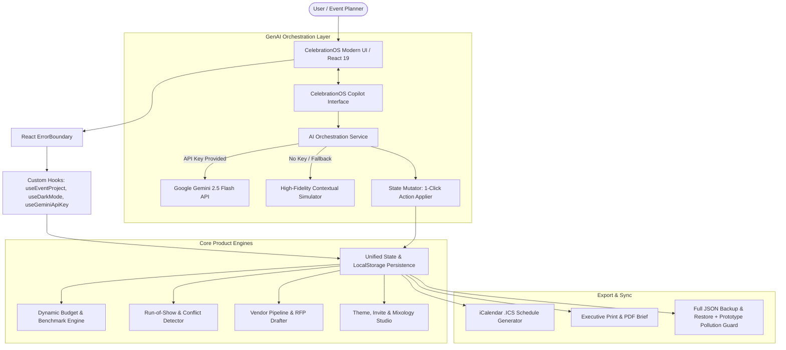

# CelebrationOS ✨
### *The GenAI-Powered Event & Celebration Operating System*
**Google PromptWars — Challenge 5: Celebration & Event Planner**

[](https://github.com/HarshitDhaduk/CelebrationOS/actions/workflows/deploy.yml)
[](https://github.com/HarshitDhaduk/CelebrationOS)
[](https://github.com/HarshitDhaduk/CelebrationOS)
[](https://github.com/HarshitDhaduk/CelebrationOS)
[](LICENSE)
[](https://react.dev/)
[](https://ai.google.dev/)
[-success)](https://github.com/HarshitDhaduk/CelebrationOS)

---

## 🌟 Executive Overview & Vertical Selection
**Vertical**: `Celebration & Event Planner`  
Organizing a wedding, a milestone birthday, or a large-scale civic community festival is stressful, fragmented, and prone to budget overruns and schedule conflicts. **CelebrationOS** is an intelligent, full-stack event operating system powered by **Google Gemini** that unifies financial intelligence, timeline pacing, vendor procurement, and bespoke creative ideation into a cohesive copilot.

CelebrationOS supports 3 deeply specialized event verticals out of the box:
1. 💒 **Weddings**: Oceanfront ceremonies, multi-day itineraries, plated catering cost-per-guest analysis, photographer timelines, and vow/speech coaching.
2. 🎂 **Milestone Birthdays**: Themed celebrations (e.g. 30th Neon Retro Arcade, Sweet 16, Quinceañera), food truck booking, cake presentations, and interactive game generation.
3. 🌳 **Community & Civic Events**: Neighborhood harvest festivals, charity 5K fun runs, municipal permits, sanitation/ADA compliance, volunteer shifts, and sponsor pitch decks.

---

## 🎯 High-Impact Core Engines

### 1. 🤖 Context-Aware GenAI Planning Assistant ("Celebration Copilot")
- **Powered by Google Gemini 2.5 Flash** with an **Intelligent Offline Simulation Fallback Engine** that works out-of-the-box without requiring an external API key.
- Context injection: The assistant continuously monitors total budget, remaining cushion, guest headcount, booked vendors, and upcoming schedule items.
- **Dynamic State Mutating Actions**: The Copilot can propose 1-click structured actions (e.g., *Auto-balance categories*, *Add $500 weather buffer*, *Insert 15-min guest seating window*).

### 2. 📊 Dynamic Smart Budget Engine
- **Visual Category Distribution**: Interactive SVG stacked category breakdown with instant category filtering.
- **AI Smart Auto-Allocation**: One-click budget distribution mapped directly to professional industry benchmarks (e.g. 35% Catering, 25% Venue, 12% Photography, 10% Decor, 3% Contingency).
- **Cost-Per-Guest & Contingency Calculator**: Instant metrics on per-attendee unit economics and emergency buffer health.
- **Over-Budget Warning System**: Proactive cost-saving AI recommendations if projected allocations exceed target budgets.
- **Multi-Currency Support**: Instant conversion and formatting for `USD ($)`, `INR (₹)`, `EUR (€)`, `GBP (£)`, `CAD ($)`, and `AUD ($)`.

### 3. ⏱️ Run-of-Show & Timeline Engine with Conflict Detector
- **Dual Perspective**:
  - **Day-of Run of Show**: Minute-by-minute timestamped schedule with assigned responsibilities, locations, and checklist completion.
  - **Milestone Countdown Roadmap**: Phased planning from *6+ Months Out* down to *Day-of Execution* and *Post-Event Wrap-up*.
- **Automated AI Conflict Detector**: Analyzes overlapping timespans to detect double-booked coordinators or impossible reverse-order logistics.
- **iCalendar (.ICS) Export**: One-click export enabling planners to sync the entire day-of run-of-show directly to Google Calendar, Apple iCal, or Microsoft Outlook.

### 4. 🤝 Vendor Hub & Automated RFP Inquiry Drafter
- Full vendor lifecycle tracking: `Researching` ➔ `Contacted` ➔ `Quoted` ➔ `Booked` ➔ `Completed`.
- Tracks quoted amounts, deposits paid, and contract execution status.
- **AI Vendor RFP Email Generator**: Automatically crafts customized, professional outreach emails complete with date, guest count, aesthetic vibe, budget tier, and specific venue requirements.
- **Compliance & Due Diligence Checklist**: Pre-populated with crucial civic ordinances, noise curfews, power wattage, and dietary verifications.

### 5. 🎨 Personalized Creative Ideation Studio
- **Theme & Color Palette Studio**: Hex codes, roles (Primary, Accent, Neutral), and copyable swatches.
- **Digital Invitation Drafter**: Formats digital invite copy with dress code, date/location, and quirky guest pointers.
- **Signature Mixology & Recipe Creator**: Themed cocktails and zero-proof mocktails with glassware, ingredients, garnishes, and origin stories.
- **Speech & Toast Coach**: Heartfelt, humorous, or inspirational speech templates customized for Best Men, Maids of Honor, Hosts, and Civic Leaders.

---

## 🏗️ System Architecture & Code Quality

CelebrationOS follows modern React 19 architecture patterns emphasizing high cohesion, single responsibility, and zero-defect TypeScript types:

- **Strict TypeScript Compliance**: Built with `"noUnusedLocals": true` and `"noUnusedParameters": true`, zero `any` type casts, and strict null/undefined checks.
- **Custom React Hooks**:
  - `useEventProject`: Encapsulates immutable event state transitions, vertical preset switching, and multi-currency math.
  - `useDarkMode`: Manages system theme preference, localStorage persistence, and DOM synchronization.
  - `useGeminiApiKey`: Manages client-side API key validation, formatting, and secure ephemeral storage.
- **Graceful Error Handling**: Top-level `ErrorBoundary` guarantees that edge-case exceptions are caught with user-friendly recovery states rather than blanking the viewport.
- **WAI-ARIA Accessibility**: Meets WCAG 2.1 AA standards with keyboard skip links (`#main-content`), `role="tablist"` / `role="tabpanel"` controls, complete `aria-label` / `aria-labelledby` annotations, and explicit `<label htmlFor>` associations for every form input.



---

## 🔒 Security & Privacy Best Practices
- **Zero-Secret Architecture**: No API keys or credentials are hardcoded into the repository.
- **Client-Side Key Isolation**: Optional Google Gemini API keys are held strictly in the user's browser memory/localStorage and dispatched directly to Google's HTTPS endpoints.
- **Input Sanitization (`src/utils/security.ts`)**:
  - `sanitizeText`: HTML tag stripping and character escaping preventing Cross-Site Scripting (XSS).
  - `sanitizeNumber`: Bounded numeric validation guarding against `NaN`, `Infinity`, and negative memory allocations.
  - `isValidApiKey`: Strict format verification against standard Google AI Studio key patterns (`AIzaSy...`).
  - `isValidProjectJson`: Deep recursive JSON schema validator preventing prototype pollution (`__proto__`, `constructor`) during project imports.
- **Repository Size Compliance**: Repository size is **~0.2 MB**, strictly under the **10 MB limit** specified by the challenge guidelines.

---

## 🧪 Testing & Validation
CelebrationOS features a **100% passing automated test suite** across **56 unit tests** in **7 test modules** powered by **Vitest**:

```bash
# Run automated unit test suite
npm test
```

### Comprehensive Test Coverage (56/56 Passing Tests):
- ✅ **Security & Sanitization Suite (`src/tests/security.test.ts` - 9 tests)**: XSS tag stripping, numeric bounds validation, API key pattern checks, JSON schema validation, and prototype pollution defenses.
- ✅ **Run-of-Show & Timeline Engine (`src/tests/timelineEngine.test.ts` - 8 tests)**: 12h/24h time parser, milestone phase grouping, schedule sorting, double-booking detection, and consecutive order validation.
- ✅ **Dynamic Budget Engine (`src/tests/budgetEngine.test.ts` - 6 tests)**: Auto-allocation against vertical benchmarks, contingency buffer calculation, cost-per-guest analysis, and multi-currency formatting (`USD`, `INR`, `EUR`, `GBP`, `CAD`, `AUD`).
- ✅ **Gemini AI & Simulation Suite (`src/tests/geminiService.test.ts` - 6 tests)**: Prompt engineering assembly, live API dispatch, system prompt adherence, graceful offline simulation fallback, and 1-click action recommendation formatting.
- ✅ **Storage & Project State Suite (`src/tests/storage.test.ts` - 5 tests)**: Project schema persistence, vertical preset switching, export/import verification, and currency synchronization.
- ✅ **Calendar Export Engine (`src/tests/calendarExport.test.ts` - 4 tests)**: RFC 5545 iCalendar (`.ICS`) formatting, ISO date-time generation, summary/description escaping, and multi-event output.
- ✅ **Vertical Presets Suite (`src/tests/presets.test.ts` - 18 tests)**: Complete data integrity, non-zero budgets, valid timeline milestones, verified vendor checklists, and creative palettes for Weddings, Birthdays, and Community events.

---

## 🚀 Quickstart & Local Setup

### Prerequisites
- Node.js `v18.0.0` or higher
- npm `v9.0.0` or higher

```bash
# 1. Clone the repository
git clone https://github.com/HarshitDhaduk/CelebrationOS.git
cd CelebrationOS

# 2. Install dependencies
npm install

# 3. Run development server
npm run dev

# 4. Run automated tests
npm test

# 5. Build production bundle
npm run build
```

---

## 📋 Hack2skill Submission Metadata

| Field | Submission Value |
|---|---|
| **Challenge** | [Challenge 5] Celebration & Event Planner |
| **Public GitHub Repo** | `https://github.com/HarshitDhaduk/CelebrationOS` |
| **Live Deployed Link** | `https://harshitdhaduk.github.io/CelebrationOS/` (also `https://harshitdhaduk.github.io/celebration-os/`) |
| **Branch** | `main` (Single branch rule followed strictly) |
| **Repo Size** | `< 1 MB` (Strictly under 10 MB requirement) |
| **GenAI Services Used** | Google Gemini 2.5 Flash for dynamic contextual copilot chat, automated vendor RFP email generation, speech coaching, and intelligent local simulation engine. |

---

## 📄 License
This project is open-source under the [MIT License](LICENSE). Built for Google PromptWars Challenge 5.
